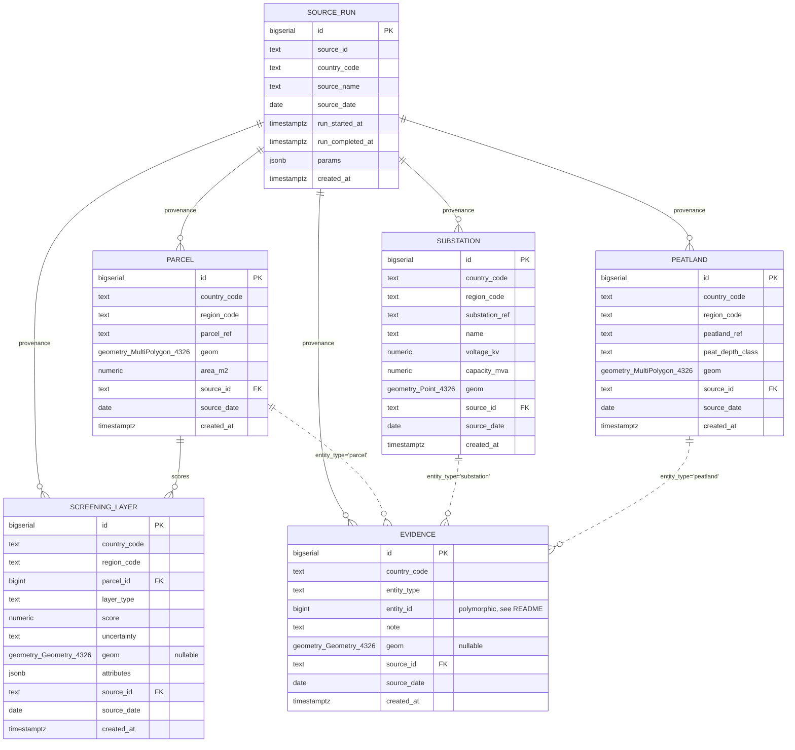

# IRIS Pilot Schema

`iris_staging` mirrors `stg_parcel` / `stg_substation` / `stg_peatland` /
`stg_screening_layer` as loosely-typed landing tables (no uniqueness, no FK,
generic `geometry(Geometry, 4326)`, `country_code` still `NOT NULL`) feeding
promotion into the `iris_core` tables shown above.

See [../README.md](../README.md) for the CRS policy, key design, and the
country-scoped uniqueness rationale.
